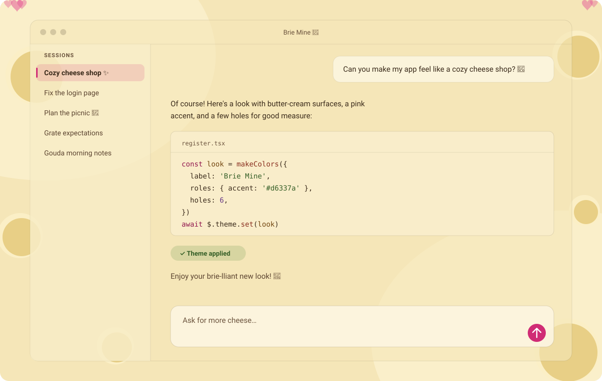
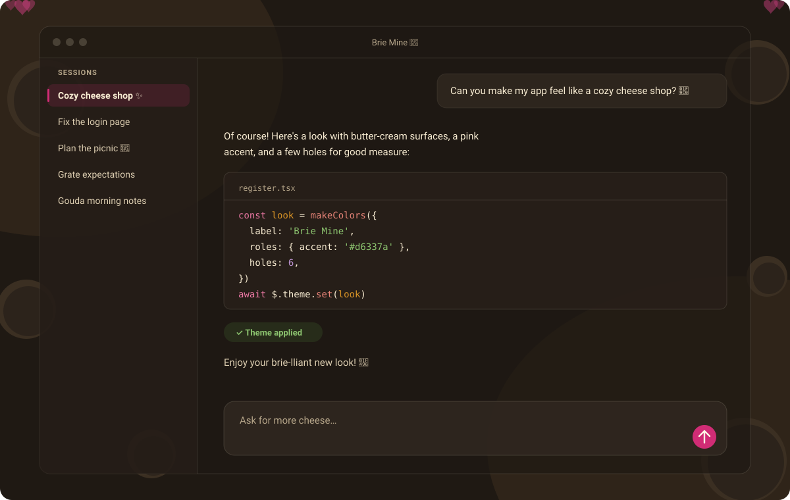

<p align="center">🧀 💖 🧀 💖 🧀</p>

<h1 align="center">Brie Mine</h1>

<p align="center"><b>A love letter to cheese, disguised as a theme for the Claude desktop and mobile apps.</b></p>

<p align="center"><i>Some themes are light. Some themes are dark. This one is aged to perfection.</i></p>

<p align="center">
  
  
</p>
<p align="center"><sub>Picnic mode on the left, cellar mode on the right. The hearts and cheese holes really do drift. 🫧</sub></p>

## 🧀 What's in the wheel

- **Butter-cream by day.** Soft golden surfaces, warm brown text and a hot-pink accent, like a fresh wheel of brie on a sunny picnic blanket.
- **Candlelit cellar by night.** Dark mode is a cozy cheese cave: deep warm browns, cream text, and the same pink glowing like a little lantern.
- **A backdrop with holes in it (on purpose).** Swiss-cheese holes bob gently while tiny pink hearts float up the edges. They stay clear of your words and the message box, and they hold perfectly still if your system asks for reduced motion.
- **No funny business with meaning.** Errors stay red, success stays green and warnings stay amber. Cheesy? Yes. Confusing? Never.

## 🍷 Pairing notes

|  | ☀️ Light mode | 🕯️ Dark mode |
| --- | --- | --- |
| **Mood** | sunny picnic | candlelit cellar |
| **Pairs with** | iced coffee and morning stand-ups | red wine and midnight refactors |
| **Page** | butter cream `#f5e6b8` | rind brown `#1f1913` |
| **Accent** | brie-mine pink `#d02c75` | the very same pink, glowing |

## 📦 Installing (it's grate easy)

At the prompt of a Claude Code terminal session:

```
/plugin install brie-mine --marketplace JStanoeva/brie-mine
```

Answer `y` to add the marketplace, then press Enter to pick the user scope.

From a shell:

```bash
claude plugin install brie-mine --marketplace JStanoeva/brie-mine
```

In the Claude desktop app: click **+** next to the prompt box, then **Plugins**, **Add marketplace** with `JStanoeva/brie-mine`, then **Add plugin**.

Then start a new session and say cheese! 📸

## 🐭 Questions from the cheese board

**Why doesn't my terminal look cheesy?**
Themes are drawn by the Claude desktop and mobile apps. The terminal keeps its own look. (It's lactose intolerant.)

**The hearts are lovely but I'd like them to sit still.**
Turn on reduced motion in your system settings and the holes and hearts politely stop drifting.

**Can I make my own cheese?**
Please do! It's MIT licensed, so fork it and age your own: Cheddar Sunset 🧡, Blue Cheese Moonlight 💙, Camembert Cloud ☁️…

## 💌 Made with

Love, far too many puns, and [Claude Code](https://claude.com/claude-code). Released under the [MIT license](LICENSE).

<p align="center"><sub>No cheese was harmed in the making of this theme. Some was eaten. 🧀</sub></p>
